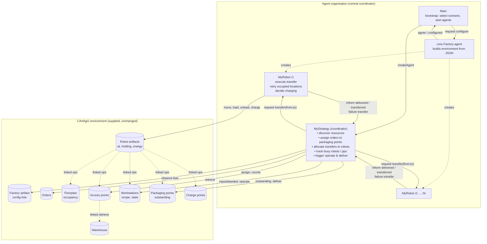
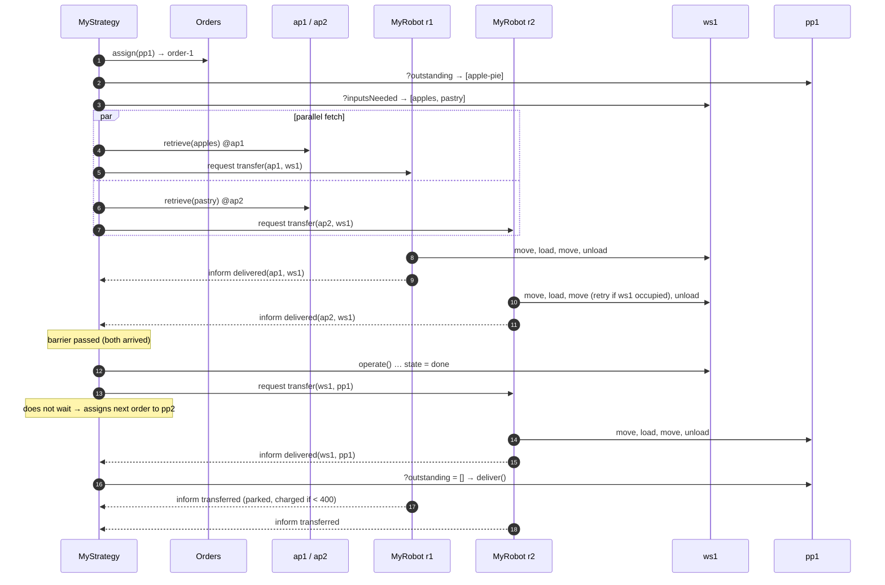
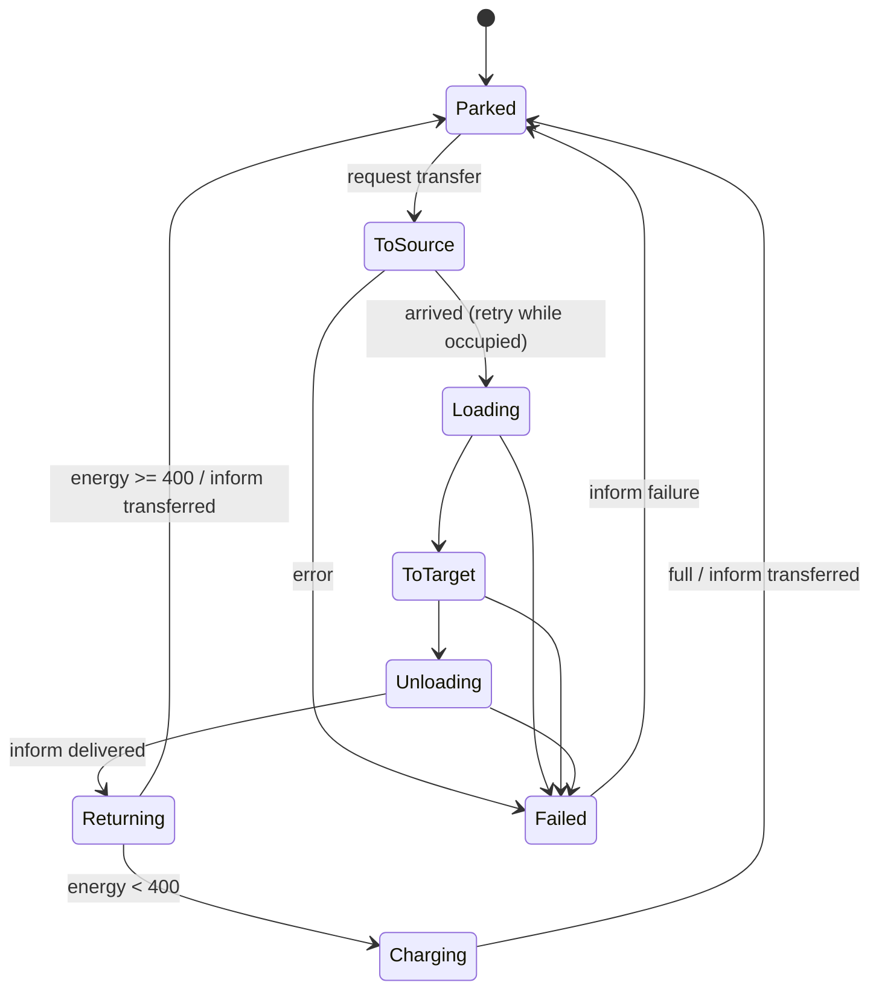
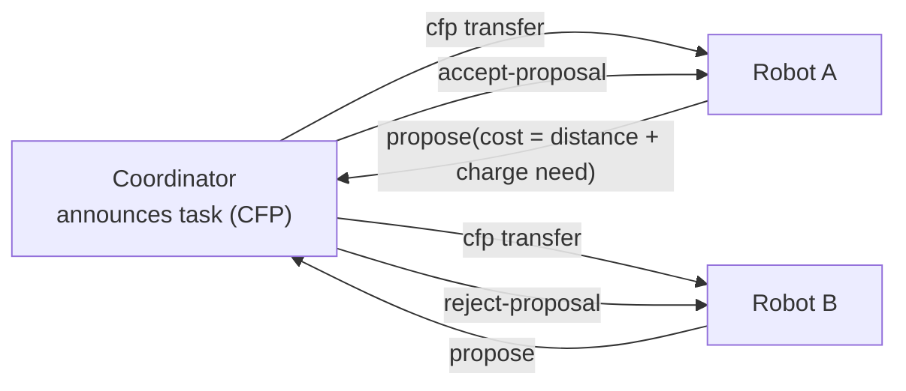

# Manufacturing Mayhem 设计图

> 配套：[SOP](sop.md) ｜ [Project-ManufacturingMayhem-报告草稿](Project-ManufacturingMayhem-报告草稿.md) ｜ [Project-ManufacturingMayhem-参考代码](Project-ManufacturingMayhem-参考代码.md)
> 用法：Obsidian 会直接渲染 Mermaid。交报告时用截图，或粘到 mermaid.live 导出 PNG/SVG。图里的名字要和报告正文保持一致（architecture diagram bonus 看的是 explanatory value 和 consistency）。

## 图 1 — Architecture（organisation + responsibilities）

**图注**：实线 = message 或 operation 调用；虚线 = artifact 之间的 linked operation（agent 不直接调用）。决策都在 agent 里做，规则检查（容量、电量、recipe）都在 artifact 里做。

## 图 2 — Worked example：一张 apple-pie 订单（easy-02）

## 图 3 — Robot 生命周期（MyRobot）

## 图 4 — Alternative（报告里用来比较）

**图注**：Contract Net 下由 robot 自己报价（考虑位置和电量），coordinator 只负责选标。好处是 robot 的本地信息能被用上；代价是每个任务多一轮通信，并发报价还要处理 commitment。easy 和 medium scenario 规模小、travelDistance 大多关闭，所以选了更简单的 central allocation。
