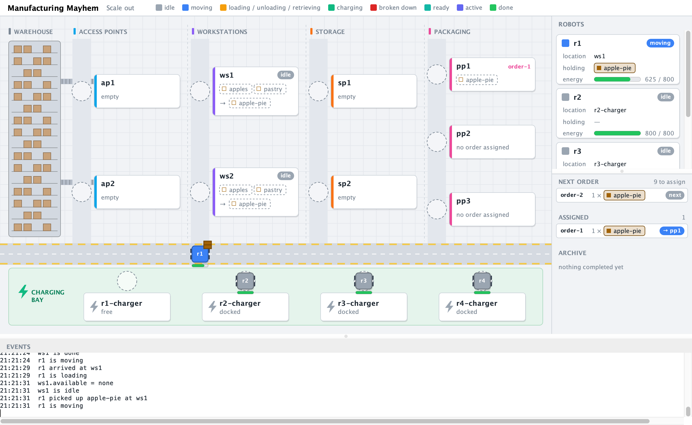
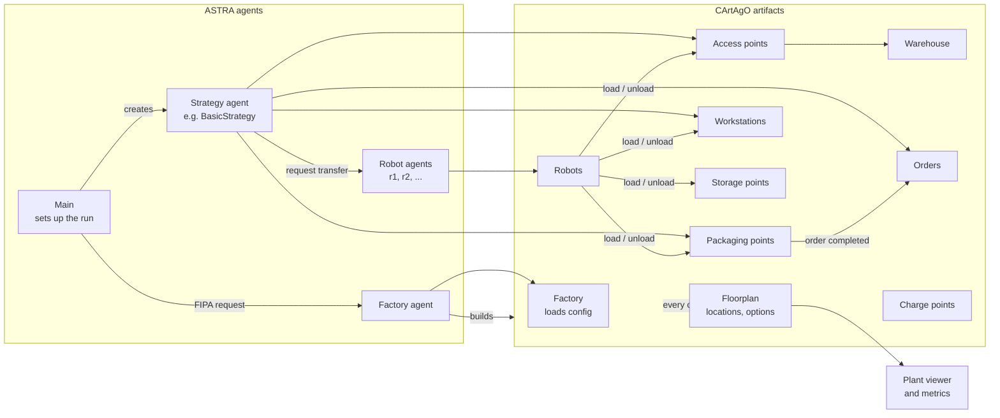
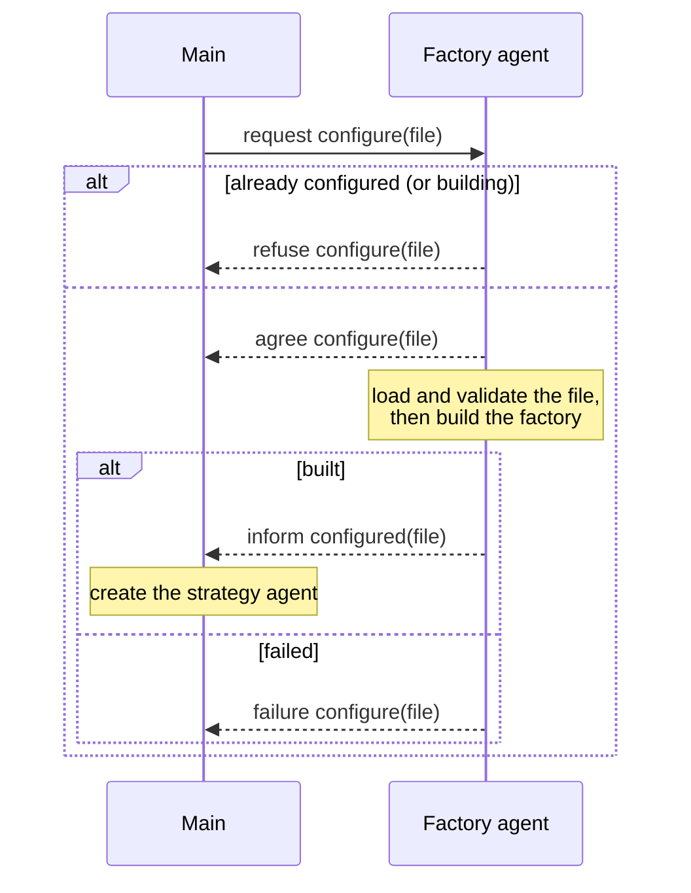

# Manufacturing Mayhem

Manufacturing Mayhem is a testbed for **multi-agent coordination**. A small factory is simulated
with [CArtAgO](https://cartago.sourceforge.net/) artifacts: a warehouse, access points,
workstations, storage points, packaging points, charge points and robots. Your
[ASTRA](https://astralanguage.com/) agents have to fulfil a stream of customer orders by
fetching ingredients, moving them between locations with robots, operating the workstations
and delivering finished products, while keeping the robots charged.

The challenge is to design a **coordination strategy** that does this well. Each run is
measured: when the last order is delivered, the simulator shows a summary of how long it took,
how much of the factory sat idle while there was work to do, where work waited between one
agent's step and the next, how evenly the work was shared, and how much effort was wasted.
Twelve scenarios, from easy to hard, add more robots, more products, multi-stage recipes,
travel distances, tight batteries, orders that arrive during the run and breakdowns.



*The plant viewer running `medium-05-scale-out` with the sample strategy. The sample uses only
r1, so r2–r4 wait in the charging bay: exactly the kind of thing a better strategy improves.*

---

## Contents

1. [Quick start](#quick-start)
2. [How the simulation works](#how-the-simulation-works)
3. [Walkthrough: key steps](#walkthrough-key-steps)
4. [Writing a strategy](#writing-a-strategy)
5. [Components reference](#components-reference)
6. [Configuration reference](#configuration-reference)
7. [Scenarios](#scenarios)
8. [Metrics](#metrics)
9. [Project layout](#project-layout)
10. [Troubleshooting](#troubleshooting)

---

## Quick start

**You need:** Java 17 or later and Maven 3. The first build downloads dependencies, so it needs
an internet connection.

```bash
mvn compile astra:deploy
```

`mvn compile` compiles both the Java code and the ASTRA agents; `astra:deploy` runs the `Main`
agent, which sets up the simulation. Always compile before running: `astra:deploy` on its own
runs whatever was compiled last.

What happens:

1. `Main` creates a `core.Factory` agent and asks it to build the factory described in
   `config/factory.json`.
2. The plant viewer opens and the factory appears: locations, robots in the charging bay, and
   the orders in the sidebar.
3. `Main` then creates the strategy agent, `BasicStrategy`, which works through the orders with
   robot `r1`, making apple pies.
4. When every order has been delivered, a **Simulation Summary** window opens. Use
   **Save as JSON…** or **Save as CSV…** to keep it. Each run's raw event log is written to
   `results/run-<date-time>/events.csv`.

### Running a scenario

`Main` names the configuration file in its request to the factory agent
(`src/main/astra/Main.astra`):

```
send(request, "factory", configure("config/factory.json"));
```

Change the path to any file in `config/`, e.g. `"config/medium-05-scale-out.json"`, and run
again. Paths are relative to the project directory. The sample `BasicStrategy` can run the
scenarios that only make apple pies at `ws1` using `ap1`, `sp1`, `pp1` and `r1` (scenarios 01–06,
09 and 10); the others need a strategy of your own.

### Running your own strategy

`Main` starts the strategy once the factory is ready:

```
S.createAgent("strategy", "BasicStrategy");
```

Replace `BasicStrategy` with the name of your strategy agent (see
[Writing a strategy](#writing-a-strategy)). To replace `Main` itself, run a different main agent
with:

```bash
mvn compile astra:deploy -Dastra.main=MyMain
```

---

## How the simulation works



* **Agents** make the decisions. The sample has four kinds: `Main` (sets up the run), the
  `Factory` agent (builds the factory), the strategy agent (`BasicStrategy`, which decides what
  happens) and `Robot` agents (one per robot, carrying out transfers when asked).
* **Artifacts** are the factory. Agents act on them through **operations** and see their state
  through **observable properties**. Artifacts talk to each other through **links**.
* The **Floorplan** artifact is the simulation's environment: it knows every location and which
  robot is where, applies the scenario's options (travel distance, breakdowns), and passes every
  change to the **plant viewer** and the **metrics**.
* **Items** are physical: a robot holds at most one item, an access point or storage point holds
  at most one, and a location holds at most one robot.

### The basic rules

Everything a robot does takes time and uses energy, and these costs are what make some
strategies better than others. Every action in the table is an operation on an artifact. When
an agent asks for one that isn't possible (a move to an occupied location, loading where there
is nothing to load, operating a workstation that is still missing inputs), the operation fails
and the agent's plan has to deal with it. The failure is also counted in the run's metrics.

Energy is the main constraint. A robot starts fully charged at its charge point and loses
energy with every move, load and unload, and only gets it back by returning to a charge point.
A robot that runs too low can't finish what it is doing, so a strategy has to plan when to
charge. The checks happen before an action starts: a robot needs enough energy for the whole
move, and at least 100 energy to begin loading or unloading.

Times are real time. A move that takes 4 s keeps that robot busy for 4 s while the rest of the
factory carries on, so robots, workstations and agents can all work at the same time if the
strategy lets them.

| | |
|---|---|
| **Moving** | 4 s and 100 energy per move, or with `travelDistance` on, 1 s and 25 energy per unit of distance. A move fails if the target location is occupied or the robot does not have the energy. |
| **Loading / unloading** | 2 s and 50 energy. The robot needs at least 100 energy to start. Robots load from access points, storage points and workstations, and unload to packaging points, storage points and workstations. |
| **Charging** | Only at a charge point. Each step takes 1 s and adds that charge point's charge rate, up to the robot's maximum. |
| **Workstations** | `idle` → `ready` (when all inputs are given) → `active` (while operating, for `duration` ms) → `done` (output waiting) → back to `idle` or `ready` when the output is taken. `operate` fails if the workstation is not ready or its last output has not been collected. |
| **Orders** | Each order is for 1 or 2 of one item. Orders are assigned to packaging points in the order they were created; a packaging point fills one order at a time. |

For example, with travel distance off, a transfer by the sample robot agent works out like
this:

| Step | Time | Energy |
|---|---|---|
| move from its charger to `ap1` | 4 s | 100 |
| load the item | 2 s | 50 |
| move to `ws1` | 4 s | 100 |
| unload the item | 2 s | 50 |
| move back to its charger | 4 s | 100 |
| **total** | **16 s** | **400** |

That's half the battery of a robot with the default 800 energy, and the robot then spends
more time charging. Going straight on to the next transfer instead of returning to the
charger after each one, and charging only when needed, saves both time and energy.

---

## Walkthrough: key steps

### 1. Start-up: the FIPA Request protocol

`Main` creates the `Factory` agent and asks it to configure the simulation:



### 2. Building the factory

The `Factory` agent creates the `Factory` artifact, which loads the configuration and validates
it against `src/main/resources/schema/factory.schema.json`, then checks what a schema cannot:
that every name is unique and every workstation input and order item can be obtained. An
invalid file is rejected with every problem listed.

The agent then gives the scenario's name, seed and options to the floorplan, and creates, in
order: the warehouse (with its stock), access points, storage points, packaging points, the
orders, each robot with its charge point (plus a robot agent if the robot has an `agent`
class), and the workstations.

### 3. Fulfilling an order (the sample strategy)

`BasicStrategy` (`src/main/astra/BasicStrategy.astra`) looks up the artifacts it uses, then
fills each order like this:

```
!assign("pp1", string orderId);          // the next order goes to packaging point pp1
?outstanding("pp1", list needed);         // the items pp1 still needs
while (P.size(needed) > 0) {
    !available("ap1", "apples");          // fetch apples from the warehouse to ap1
    !transfer("r1", "ap1", "ws1");        // ask robot r1 to carry them to ws1
    ?inputsNeeded("ws1", list items);
    !available("ap1", P.headAsString(items));
    !transfer("r1", "ap1", "ws1");
    !operate("ws1");                      // make the apple pie
    !transfer("r1", "ws1", "sp1");        // via storage...
    !transfer("r1", "sp1", "pp1");        // ...to the packaging point
    ?outstanding("pp1", list needed2);
    needed = needed2;
}
!deliver("pp1");                          // the order is COMPLETED and archived
```

### 4. A robot transfer

The strategy sends `request transfer(from, to)` to a robot agent, which replies
`inform transferred(from, to)` when it is done. The sample `Robot` agent:

```
plan @message(request, string sender, transfer(string from, string to)) {
    !at(S.name(), from);                  // move there (fails if it is occupied)
    !holding(S.name(), string _);         // load
    !at(S.name(), to);
    !empty(S.name());                     // unload
    !at(S.name(), S.name()+"-charger");   // go back and charge until full
    !charged(S.name());
    send(inform, sender, transferred(from, to));
}
```

Charging after every transfer is simple but wasteful; deciding when to charge is part of the
challenge.

### 5. The end of a run

When the last order is delivered (and none are still to arrive), the metrics are summarised and
the **Simulation Summary** window opens.

---

## Writing a strategy

A strategy is an agent that `Main` creates once the factory has been built. It extends
`core.Base` (`src/main/astra/core/Base.astra`), which wraps the artifacts' operations and
properties in plans. A strategy needs to:

1. join the CArtAgO workspace: `cartago.link();`
2. **look up** the artifacts it will use, e.g. `!packagingPoint("pp1", cartago.ArtifactId id)`.
   Base's plans find an existing artifact by name (or create it), and record a belief such as
   `packagingPoint("pp1", id)` that the other plans need,
3. coordinate the work, by acting on the artifacts and sending requests to the robot agents.

Here is a complete strategy that shares the work between two robots in `easy-02-two-robots`.
Save it as `src/main/astra/TwoRobots.astra`, change `Main` to configure
`config/easy-02-two-robots.json` and to create `"TwoRobots"` instead of `"BasicStrategy"`, and
run it:

```
agent TwoRobots extends core.Base {
    initial !start();

    plan +!start() {
        cartago.link();

        // Find the artifacts the factory agent created
        !floorplan(cartago.ArtifactId fpId);
        !robot("r1", cartago.ArtifactId r1Id);
        !robot("r2", cartago.ArtifactId r2Id);
        !warehouse(cartago.ArtifactId wId);
        !accessPoint("ap1", cartago.ArtifactId ap1Id);
        !accessPoint("ap2", cartago.ArtifactId ap2Id);
        !storagePoint("sp1", cartago.ArtifactId spId);
        !packagingPoint("pp1", cartago.ArtifactId pp1Id);
        !workstation("ws1", cartago.ArtifactId wsId);
        !orders(cartago.ArtifactId oId);

        ?outstandingOrders(int waiting);
        while (waiting > 0) {
            !assign("pp1", string orderId);
            ?outstanding("pp1", list needed);
            while (P.size(needed) > 0) {
                // r1 brings the apples and r2 the pastry
                !available("ap1", "apples");
                !transfer("r1", "ap1", "ws1");
                !available("ap2", "pastry");
                !transfer("r2", "ap2", "ws1");
                !operate("ws1");

                // whichever robot has more charge takes the pie to the packaging point
                ?chargeLevel("r1", int r1Level);
                ?chargeLevel("r2", int r2Level);
                if (r1Level >= r2Level) {
                    !transfer("r1", "ws1", "pp1");
                } else {
                    !transfer("r2", "ws1", "pp1");
                }
                ?outstanding("pp1", list stillNeeded);
                needed = stillNeeded;
            }
            !deliver("pp1");
            ?outstandingOrders(int left);
            waiting = left;
        }
    }

    plan +!transfer(string robot, string from, string to) {
        send(request, robot, transfer(from, to));
        wait(transferred(from, to));
        -transferred(from, to);
    }

    plan @message(inform, string sender, transferred(string from, string to)) {
        +transferred(from, to);
    }
}
```

It uses both robots, but still one step at a time. Ideas for doing better:

* **Work in parallel:** give each robot its own stream of work (e.g. one packaging point or one
  workstation each) rather than waiting for every transfer to finish.
* **Choose robots well:** by charge level (`?chargeLevel`), position (`?at`) or whether they are
  `broken`.
* **Charge only when needed**, before a move would fail.
* **Avoid collisions:** check `?free(location)` and take turns at shared locations.
* **Keep bottlenecks busy:** have inputs waiting before a slow workstation finishes.
* **Handle failure:** wrap risky steps in `try { ... } recover { ... }`.
* **Give robots more autonomy:** the `Robot` agent is yours to change too.

Agents can also **focus** on an artifact (`cartago.focus(id)`) so that its observable properties
become beliefs, e.g. a robot agent focusing on its robot sees `cartago.at(location)`.

### Base plans

| Plan | What it does |
|---|---|
| `!floorplan(id)`, `!warehouse(id)`, `!orders(id)` | Look up (or create) the artifact. |
| `!accessPoint(name, id)`, `!storagePoint(name, id)`, `!packagingPoint(name, id)`, `!workstation(name, id)` | Look up (or create) a location. `!accessPoint` needs `!warehouse` first. |
| `!robot(name, id)` | Look up (or create) a robot and its charge point. Also `!robot(name, maxEnergy, id)` and `!robot(name, maxEnergy, chargeRate, id)`. |
| `?locations(list)` | Every location's name. |
| `?free(location)` | Succeeds if no robot is there. |
| `!addToWarehouse(item, quantity)` | Add stock. |
| `!available(ap, item)` | Fetch an item from the warehouse to an access point. |
| `?available(name, item)` | The item at an access point or storage point (`"none"` if empty). |
| `!at(robot, location)` | Move the robot there, unless it is already there. Fails if the location is occupied. |
| `?at(robot, location)` | Where the robot is. |
| `!holding(robot, item)` / `!empty(robot)` | Load the item at the robot's location / unload it. |
| `?holding(robot, item)` | What the robot holds (`"none"` if nothing). |
| `!charged(robot)` | Charge until full (the robot must be at a charge point). |
| `?chargeLevel(robot, level)` | The robot's energy. |
| `!configure(ws, inputs, output, duration)` | Set a workstation's recipe (the factory agent does this). |
| `?inputsNeeded(ws, list)` | Inputs the workstation still needs. |
| `?state(ws, state)` | `idle`, `ready`, `active`, `done` or `broken`. |
| `!operate(ws)` | Operate a ready workstation and wait until it is done. |
| `!assign(pp, orderId)` | Assign the next order to a packaging point; binds its id. |
| `?nextOrder(id, item, quantity)` | The next order to assign (`"none"` if none is waiting). |
| `?outstandingOrders(n)`, `?ordersToArrive(n)`, `?assignedOrders(n)` | Orders waiting to be assigned / not yet arrived / assigned but not delivered. |
| `?outstanding(pp, list)` | Items a packaging point still needs for its order. |
| `!deliver(pp)` | Deliver a packaging point's complete order. |

---

## Components reference

Operations agents call are marked **op**; links (called by other artifacts) are marked
**link**. Most operations fail with a message saying why; the failure is also recorded in the
run's metrics.

### Factory
Loads and validates a configuration file.

| | |
|---|---|
| **op** `load(file)` | Load and validate a configuration (relative to the project directory). |
| **op** `scenario(name, description, seed)`, `options(...)`, `stock(item, qty)`, `workstation(name, inputs, output, duration)`, `robot(name, maxEnergy, chargeRate, agent)`, `orderCount(n)` | Read the loaded configuration. |
| **properties** | `configuration`, and lists of names: `warehouse`, `accessPoints`, `storagePoints`, `packagingPoints`, `workstations`, `robots`, `orderItems`. |

### Floorplan
The factory floor and the simulation's environment.

| | |
|---|---|
| **op** `configureScenario(...)` | Set the scenario's options (the factory agent does this). |
| **op** `isOccupied(location, occupied)` | Whether a robot is at a location. |
| **link** `location(name, id)`, `move(...)`, `place(...)`, `travel(from, to, units)`, `breakdown(...)`, `recordFailure(...)` and the viewer updates | Used by the other artifacts. |
| **properties** | `locations`: every location's name. |

### Warehouse
| | |
|---|---|
| **op** `add(item, quantity)` | Add stock. |
| **link** `retrieve(item, Item)` | Take one item (used by access points); fails if none is left. |
| **properties** | One per item type: its quantity. |

### Access point
| | |
|---|---|
| **op** `retrieve(item)` | Fetch one item from the warehouse. |
| **link** `take(Item)` | A robot loads the item. |
| **properties** | `available`: the item held, or `"none"`. |

### Storage point
Holds one item until a robot collects it.

| | |
|---|---|
| **link** `give(Item)`, `take(Item)` | A robot unloads / loads. `give` fails if it is full. |
| **properties** | `available`: the item held, or `"none"`. |

### Workstation
| | |
|---|---|
| **op** `configure(inputs, output, duration)` | Set the recipe. |
| **op** `operate()` | Make the output (status `active` for `duration` ms, then `done`). |
| **link** `give(Item)`, `take(Item)` | A robot unloads an input / loads the output. |
| **properties** | `state`, `inputs`, `output`, `inputsNeeded`, `duration`. |

### Packaging point
Fills one order at a time.

| | |
|---|---|
| **op** `deliver()` | Deliver the order once every item has been given; tells `Orders` it is complete. |
| **link** `assign(...)` | `Orders` gives it an order; fails if it already has one. |
| **link** `give(Item)` | A robot unloads an item the order needs. |
| **properties** | `order` (id or `"none"`), `items` (everything the order needs), `outstanding` (still to come). |

### Orders
| | |
|---|---|
| **op** `configure(items, count, seed, initialOrders, meanInterval)` | Create the orders (the factory agent does this). |
| **op** `assign(packagingPoint, id)` | Assign the next order; binds its id. |
| **link** `completed(id)` | A packaging point delivered the order. |
| **properties** | `nextOrder(id, item, quantity)`, `outstandingOrders`, `ordersToArrive`, `assignedOrders`, `assignedOrder(id, item, quantity, packagingPoint)` per assigned order, `completedOrder(id, item, quantity, packagingPoint, duration)` per completed order, `archive`, `items`. |
| **signal** | `newOrder(id, item, quantity)` when an order arrives during the run. |

### Robot and charge point
Each robot `rN` is created with a charge point `rN-charger`, where it starts fully charged.

| | |
|---|---|
| **op** `move(location)`, `load()`, `unload()`, `charge()` | See [the basic rules](#the-basic-rules). |
| **robot properties** | `at`, `holding`, `state` (`idle`, `moving`, `loading`, `unloading`, `broken`), `energy`, `maxEnergy`. |
| **charge point properties** | `chargeRate`. |

### Plant viewer
Draws the floor (columns of locations, lanes, the main aisle and the charging bay), robots
moving with what they carry and their energy, a card per location, the sidebar of robots and
orders, and the event log. Colours show status; dashed item chips are expected but not yet
present.

---

## Configuration reference

Configurations are JSON files in `config/`, validated against
`src/main/resources/schema/factory.schema.json` (editors that support JSON Schema offer
completion via the file's `"$schema"` line).

```json
{
  "$schema": "../src/main/resources/schema/factory.schema.json",
  "name": "Two robots",
  "description": "Tests whether a strategy shares the work rather than leaving a robot idle.",
  "seed": 202,
  "warehouse": { "apples": 8, "pastry": 8 },
  "accessPoints": ["ap1", "ap2"],
  "storagePoints": ["sp1"],
  "packagingPoints": ["pp1", "pp2"],
  "workstations": [
    { "name": "ws1", "inputs": ["apples", "pastry"], "output": "apple-pie", "duration": 2000 }
  ],
  "robots": [
    { "name": "r1", "maxEnergy": 800, "chargeRate": 300, "agent": "Robot" },
    { "name": "r2", "maxEnergy": 800, "chargeRate": 300, "agent": "Robot" }
  ],
  "orders": { "items": ["apple-pie"], "count": 4 },
  "options": {
    "travelDistance": { "enabled": false },
    "orderArrivals": { "enabled": false, "initialOrders": 1, "meanInterval": 30000 },
    "breakdowns": { "enabled": false, "probability": 0.05, "repairTime": 15000 }
  }
}
```

| Field | Required | Description |
|---|---|---|
| `name` | | A label, shown in the viewer and the summary. Defaults to the file name. |
| `description` | | What the scenario tests. |
| `seed` | | Fixes the random choices (orders, arrival times, breakdowns) so a run can be repeated. Without one, a seed is chosen and shown in the summary. With several agents, timing still varies slightly between runs. |
| `warehouse` | ✓ | Starting stock: item → quantity. |
| `accessPoints` | ✓ | Names. Items from the warehouse are fetched to these. |
| `storagePoints` | | Names. Each holds one item. |
| `packagingPoints` | ✓ | Names. Each fills one order at a time. |
| `workstations` | ✓ | `name`, `inputs` (repeat an item to need more than one), `output`, `duration` (ms). |
| `robots` | ✓ | `name`; `maxEnergy` (default 800); `chargeRate` of its charge point (default 300); `agent`, the ASTRA agent class to control it (leave out for no agent). |
| `orders` | ✓ | `items` that can be ordered, and `count`, how many orders. |
| `options` | | See below. All are off by default; each has `enabled` so it can be switched off without deleting its settings. |

| Option | Settings | Effect |
|---|---|---|
| `travelDistance` | `enabled` | Moves cost 1 s and 25 energy per unit of distance on the floor's layout (locations are 1 unit apart within a column, columns 2 units apart, and robots drive via the main aisle). Off: every move is 4 s and 100 energy. |
| `orderArrivals` | `enabled`, `initialOrders`, `meanInterval` (ms) | `initialOrders` exist at the start; the rest arrive one at a time, each gap between half and one and a half times `meanInterval`. |
| `breakdowns` | `enabled`, `probability` (0–1), `repairTime` (ms) | Each robot move, load or unload, and each workstation operation, breaks down with this probability: the robot or workstation is `broken` for `repairTime`, then completes the operation. |

Names must be lower case (`[a-z][a-z0-9-]*`) and unique across the whole file, and may not end
in `-charger` (reserved for charge points).

---

## Scenarios

| File | What it tests |
|---|---|
| `easy-01-single-line` | One robot and one workstation: the baseline to compare against. |
| `easy-02-two-robots` | Whether a strategy uses a second robot and packaging point. |
| `easy-03-travel-distance` | Choosing nearby locations once moves cost by distance. |
| `easy-04-steady-arrivals` | Keeping up with orders that arrive over time. |
| `medium-05-scale-out` | Running work in parallel with four robots and two workstations. |
| `medium-06-bottleneck-oven` | Keeping a slow (15 s) workstation busy. |
| `medium-07-two-stage-recipe` | Pipelining: dough is made, then baked into pies. |
| `medium-08-product-mix` | Pies, cakes and bread from three workstations, with arrivals. |
| `medium-09-tight-energy` | Charging decisions with small batteries and slow chargers. |
| `hard-10-crowded-floor` | Six robots (a mixed fleet) sharing one access point and one storage point. |
| `hard-11-scarce-stock-breakdowns` | Two products competing for scarce apples, with breakdowns and arrivals. |
| `hard-12-mayhem` | Everything at once, with twenty orders. |

Every scenario has enough stock for the worst case (every order for 2), and every robot has
enough battery for the longest transfer and the trip back to its charger. Stock and batteries
are tight in the scenarios that test them.

`config/factory.json` is the configuration `Main` uses by default.

---

## Metrics

The summary (shown at the end of a run, saved as JSON or CSV) has these sections. A **run**
lasts from when the orders are created until the last one is delivered.

| Section | Metrics |
|---|---|
| **Scenario** | Name, description, seed and options. |
| **Overall** | Makespan; orders completed; mean and longest time from assignment to delivery. |
| **Idle while work available** | Robots idle while orders are unfinished; packaging points with no order while orders wait; workstations idle while their output is ordered. In seconds and % of the run. |
| **Hand-off delays** | Count, mean, longest and total time for: an order waiting to be assigned, a workstation ready but not operated, an output waiting to be collected, an item waiting at an access point or in storage, and a complete order waiting to be delivered. |
| **Load balance** | Busy and charging time per robot, orders per packaging point, operating and blocked time per workstation, and for each group the coefficient of variation (0 = perfectly even). |
| **Conflicts and waste** | Failed operations by cause; moves and distance travelled carrying nothing; charging visits and the charge left on arrival; stalls (10 s or more with nothing happening). |
| **Breakdowns** | How often each robot and workstation broke down and how long it was out of action. |

Compare strategies on the same scenario and seed. Some idle time is unavoidable (e.g. waiting
for a workstation), so use the metrics to compare strategies rather than as absolute targets.

---

## Project layout

```
config/                         scenario configurations
docs/images/                    images for this README
results/                        event logs, one folder per run (git-ignored)
src/main/astra/
    core/Base.astra             plans wrapping the artifacts (extend this)
    core/Factory.astra          builds the factory from a configuration
    Main.astra                  sets up the run and starts the strategy
    BasicStrategy.astra         the sample control strategy
    Robot.astra                 the sample robot agent
src/main/java/
    artifacts/                  the CArtAgO artifacts
    metrics/                    the metrics collector and summary
    model/                      items, locations, the floor layout
    modules/                    ASTRA modules (reading artifact properties)
    ui/                         the plant viewer and summary window
src/main/resources/schema/      the configuration schema
```

---

## Troubleshooting

* **My changes to an agent have no effect.** Run `mvn compile` (or
  `mvn compile astra:deploy`); `astra:deploy` alone does not recompile the agents.
* **"cannot find config/…".** Configuration paths are relative to the project directory (the
  one holding `pom.xml`), not to `target/`, where the simulation runs.
* **A configuration is rejected.** The factory agent replies `failure`; the console lists every
  problem with the file.
* **Two variables seem to share a value.** ASTRA identifies variables by their name's hash
  code, so two names with the same Java `hashCode` (e.g. `ppId` and `r2Id`) are treated as one
  variable. Rename one of them.
* **"SLF4J: No SLF4J providers were found"** at start-up is harmless (the schema validator's
  logging).
