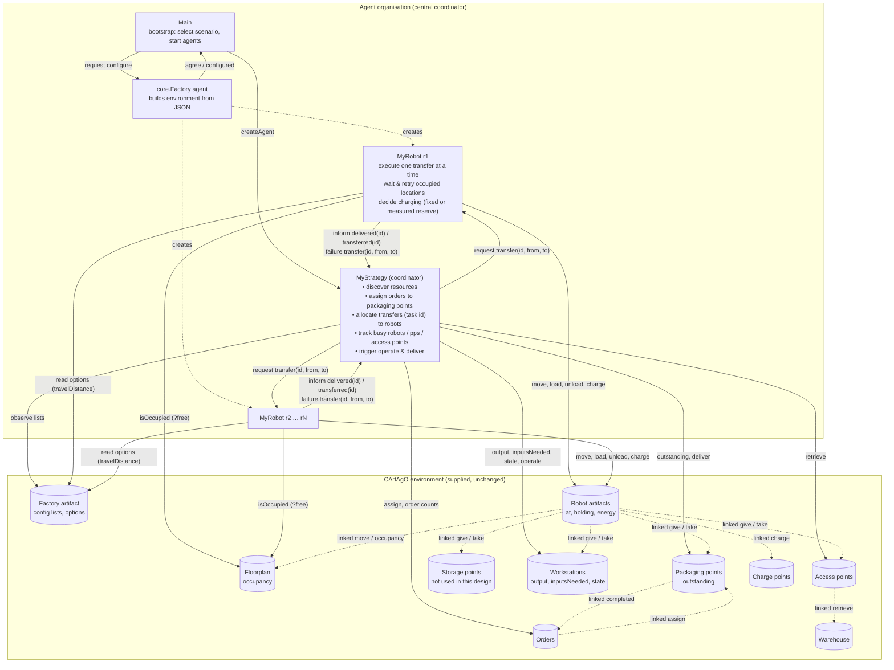
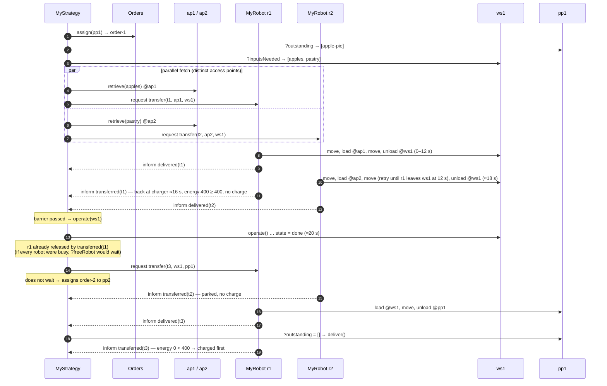
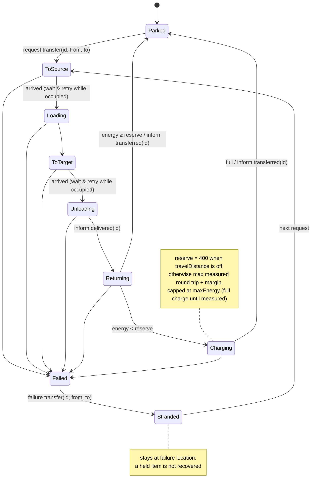
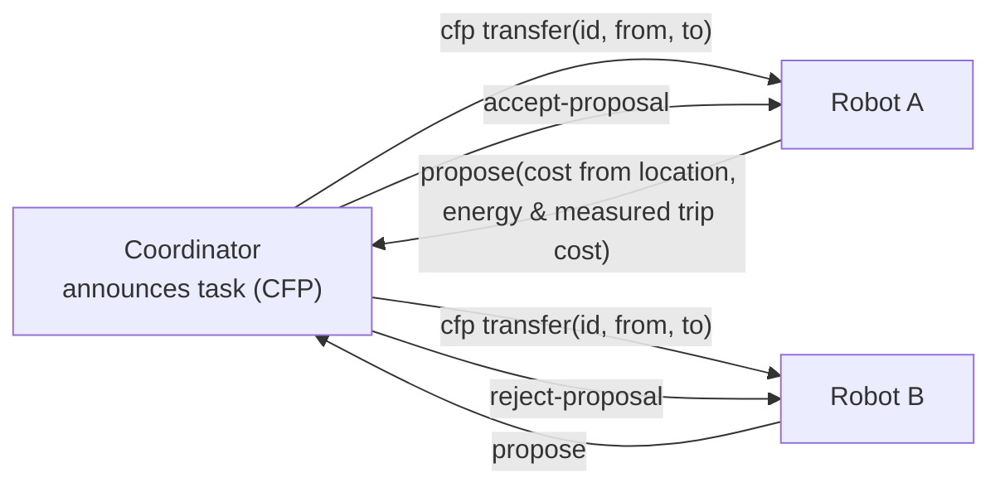

# Manufacturing Mayhem 设计图

> 配套：[SOP](sop.md) ｜ [报告草稿](报告草稿.md) ｜ [参考代码](参考代码.md)
> 用法：VS Code（装 Mermaid 预览插件）或 mermaid.live 渲染，导出 PNG/SVG 放进报告。图里的名字要和报告正文一致（architecture diagram bonus 看的是 explanatory value 和 consistency）。
> 2026-11-21 按审计意见修订：补上 StoragePoint、Robot→Floorplan、Orders↔PP 的 linked op；图 2 改正 transferred 的时序；图 3 改正重试位置和失败状态；充电改成两种模式；transfer 加上 task id。

## 图 1 — Architecture（organisation + responsibilities）

**图注**：实线 = message，或 agent 调用 operation / 读 property；虚线 = agent 创建（`creates`），或 artifact 之间的 linked operation（agent 不直接调用）。`travelDistance` 由每个 MyRobot 在启动时自己调用 factory artifact 的 `options(...)` 读取，用来决定充电 reserve。agent 负责决策；artifact 负责规则检查（容量、电量、recipe）。Storage point 在环境里存在，但本设计没有用（两级 recipe 不在支持范围内）。

## 图 2 — Worked example：一张 apple-pie 订单（easy-02，travelDistance 关闭）

**图注**：robot 回到 charger、发出 `transferred` 之后才会被释放（`-busy`）。时间按 easy-02 推演：move 4 s，load/unload 2 s，operate 2 s。`Floorplan.move` 出发时就会占住目标位置，所以两个 robot 都在 6 s 去 ws1 时，后出发的那个要重试到 12 s r1 离开为止。这样先送到的 robot 在 ≈16 s 就回到 charger 被释放，早于 operate 完成（≈20 s），派送成品时不用等待。哪个 robot 先抢到 ws1 是不确定的（短跑里是 r2）。800 电量的 robot 第一趟后剩 400，不充电；第二趟后剩 0，先充电再报告 `transferred`。

## 图 3 — Robot 生命周期（MyRobot）

## 图 4 — Alternative（报告里用来比较）

**图注**：Contract Net 下由 robot 用本地可观测的信息自己报价（当前位置、电量、实测过的单趟耗电；agent 查不到 distance），coordinator 只负责选标。好处是 robot 的本地信息能被用上；代价是每个任务多一轮通信，并发报价还要处理 commitment。必测的 easy-02、easy-04 关闭了 travelDistance，所有 scenario 的车队都不超过 6 台 robot，所以先用 central allocation。easy-03、全部 medium 和 hard 都开启了 travelDistance，在这些 scenario 里，按本地位置、电量和实测代价报价的 Contract Net 是有价值的扩展方向。
